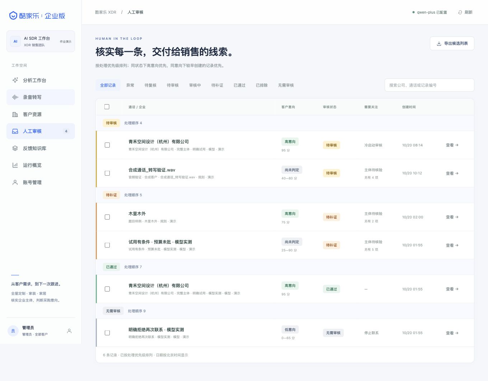
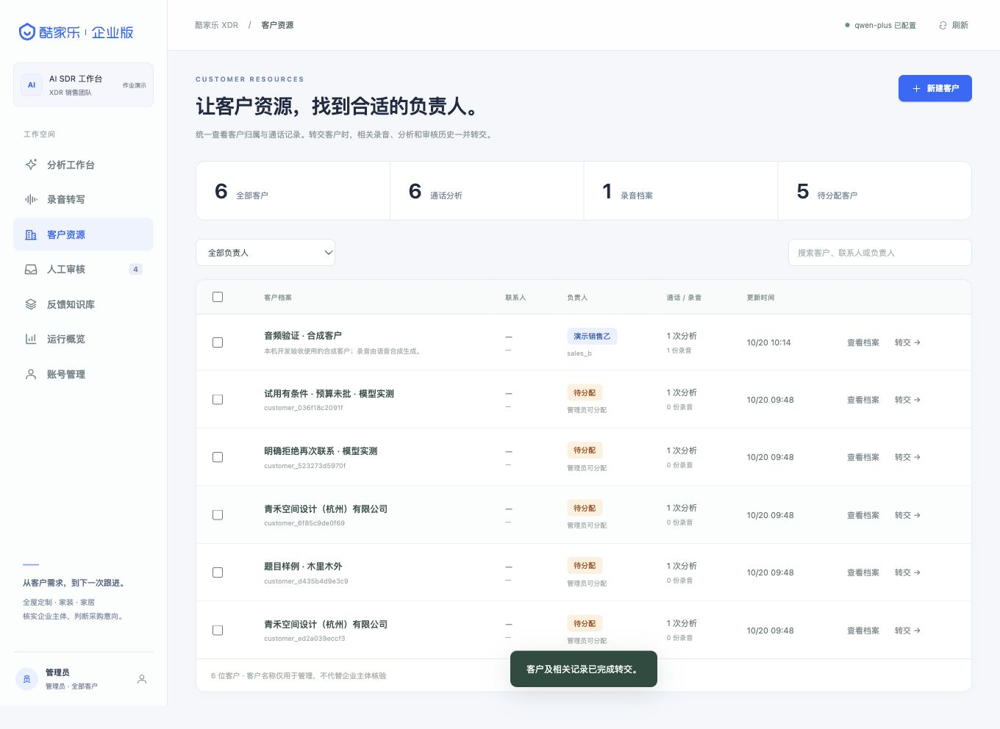

# AI SDR Agent · 销售线索工作台

<p align="center">
  
</p>

<p align="center">
  <strong>把销售通话变成有证据、有评分、可人工复核的 SQL 线索</strong>
</p>

<p align="center">
  <a href="https://github.com/dhc979917-ux/AI-SDR-Agent/actions/workflows/ci.yml"></a>
  
  
  
</p>

<p align="center">
  <a href="docs/运行过程.md">运行过程</a> ·
  <a href="docs/在线Demo部署.md">在线 Demo</a> ·
  <a href="docs/AI_SDR_Agent_设计文档.md">设计文档</a> ·
  <a href="docs/AI_SDR_Agent_设计文档.pdf">PDF</a> ·
  <a href="docs/录屏讲稿_最终版.md">录屏讲稿</a> ·
  <a href="docs/真实数据评测.md">真实评测</a>
</p>

面向酷家乐 XDR 场景的 AI 应用开发笔试项目，支持录音转写、角色确认、客户档案、企业抬头识别与还原、意向评分、审核修正和导出。这里的 SQL 指 **Sales Qualified Lead（销售合格线索）**。

**Python 3.11+ · FastAPI · SQLite · 原生 JavaScript · 无前端构建步骤**

本项目为单团队、单进程的本地演示应用。品牌素材的来源和使用说明见 [品牌与业务呈现](docs/品牌与业务呈现.md)。

---

## 界面预览

| 审核队列与优先级 | 企业抬头与审核 |
|:---:|:---:|
|  |  |
| 异常优先、待复核、批量处理 | 企查查召回、AI 重排、人工确认 |
| **审核结果** | **审核审计** |
|  |  |
| 原文证据、字段修正、异常定性 | 原始结果、人工修订、审计差异 |
| **录音与自动分析** | **客户与资源调配** |
|  |  |
| ASR、AI 分角色、自动提交 | 客户归属、管理员调配、权限隔离 |

截图为演示数据；最新界面以在线 Demo 为准。完整操作步骤见 [运行过程](docs/运行过程.md)。

---

## 在线 Demo

> 部署后把公网地址填在这里：`https://<your-service>.onrender.com`
>
> 演示账号：`admin`；密码由部署环境变量 `SDR_DEMO_ADMIN_PASSWORD` 设置。

免费 Render 实例会休眠，首次打开需要几十秒冷启动；数据不持久，启动时会重新生成合成演示数据。需要常驻和持久化时使用 `render.paid.yaml` 或自己的服务器。

无域名、无国外卡的稳定方案：香港轻量服务器 + `docker-compose.vps.yml` + Caddy + 免费 `sslip.io`，步骤见 [在线 Demo 部署](docs/在线Demo部署.md)。

---

## 运行说明

### 本地最短路径

```bash
git clone https://github.com/dhc979917-ux/AI-SDR-Agent.git
cd AI-SDR-Agent
./run.sh
```

打开 `http://127.0.0.1:8765`。这是默认本地端口，可以运行 `./run.sh --port 9000` 修改；**别人访问时请发在线 Demo 地址，不要发 `127.0.0.1`**。首次启动会生成管理员账号，凭据保存在 `var/初始管理员账号.txt`。没有配置模型密钥时，在「分析工作台」选择「离线规则演示」即可体验完整流程。

### 验证命令

```bash
.venv/bin/python -m pytest -q
node --test tests/test_audio_confirmation.cjs
.venv/bin/python scripts/evaluate.py
```

### 模型与企查查

- 登录后进入「我的模型」，分别配置语音模型和文字模型；也可以设置 `SDR_LLM_API_KEY`、`SDR_ASR_API_KEY`。
- 企查查通过 `QCC_MCP_URL` / `QCC_MCP_TOKEN` 或本机 `var/qcc-mcp.json` 配置；未配置时保留客户原话。
- 详细配置、公网部署和截图演示见 [运行过程](docs/运行过程.md) 与 [在线 Demo 部署](docs/在线Demo部署.md)。

---

## 项目解决什么问题

模型负责理解通话，规则负责评分和交付判断，人工处理缺失、冲突与异常。系统保留原始输入、模型建议和人工修订，避免把推测包装成客户事实。

- **录音到文本**：支持长录音分片转写、重试、客户识别及销售／客户角色整理，人工确认后再分析。
- **文本到线索**：字段附原文证据，企业抬头先检索企查查候选、再由人工确认全称，输出需求、时间、预算、行动四维分数。
- **线索到审核**：支持原文定位、字段修正、异常定性、独立复核、批量预览和事务提交。
- **团队协作**：员工独立配置语音和文字模型，按客户归属隔离访问，管理员负责资源调配。
- **批量处理**：多选 TXT 直接批量分析；多选录音后自动转写、AI 分角色、自动确认并提交分析，结果统一进入人工审核。
- **结果可追溯**：保存版本、修订及审计，区分候选导出与正式销售线索。

完整方案见 [设计书 Markdown](docs/AI_SDR_Agent_设计文档.md) / [设计书 PDF](docs/AI_SDR_Agent_设计文档.pdf) / [Word](docs/AI_SDR_Agent_设计文档.docx)；更细的历史版本见 [详细版](docs/AI_SDR_Agent_设计文档_改进版.md)。代码对应关系见 [实现与设计对应](docs/实现与设计对应.md)。

## 详细配置

### 手动安装

需要 Python 3.11 或更新版本，建议使用 3.12。Windows 将 Python 路径换成 `.venv\Scripts\python.exe`：

```bash
python3 -m venv .venv
.venv/bin/python -m pip install -r requirements.txt
.venv/bin/python scripts/init_admin.py
.venv/bin/python -m sdr --host 127.0.0.1 --port 8765
```

已有虚拟环境缺少依赖时，重新执行安装命令。**无需密钥即可使用「离线规则演示」**，该模式明确标识为规则结果；录音转写和真实模型分析需要配置对应服务。企查查企业抬头检索是可选能力，未配置时保留客户原话。

### 配置模型

登录后进入「我的模型」，分别选择语音模型与文字模型，填写各自 API Key，测试后保存。每个员工独立配置，无需重启；语音模型用于 ASR，文字模型用于客户身份识别、角色整理和通话分析。密钥在服务端加密保存，页面不回显明文。

当前提供阿里云百炼、OpenAI 的转写适配，以及阿里云百炼、OpenAI、DeepSeek 的文字适配。适配测试与真实凭据联调的范围见 [个人模型配置](docs/个人模型配置.md)；连接测试成功不代表所有音频和模型能力都已验证。

### 本地离线转写（可选 · FunASR）

在「我的模型」中还可以选择 **FunASR · 本地离线（无需密钥）**：转写在服务进程内运行，录音不上传第三方，也不需要 API Key。默认在服务器上安装依赖并下载模型后即可使用。

```bash
.venv/bin/python -m pip install funasr torch
```

- 支持 `paraformer-zh`（带标点、毫秒级时间戳、CAM++ 匿名说话人标签、热词）和 `sensevoice-small`（含情绪标签的轻量模型）。其他保持云端适配不变。
- **品牌热词**：在 `var/asr-hotwords.txt` 每行写一个品牌词（可带 1–100 权重，默认 20），例如 `木里木外`，可显著降低品牌简称在转写中被写错的概率——这正是企业抬头识别（评分权重 30%）的源头错误。热词仅对 Paraformer 模型生效。
- **声学说话人线索**：FunASR 返回匿名说话人标签和时间戳，作为 AI 分角色的声学证据（`speaker_roles: acoustic_segments`）。匿名标签只区分“这是两个不同的人”，不代表已知身份；角色仍需人工确认。
- 首次调用会下载模型权重（数百 MB）；模型按进程缓存，加载失败保留可重试的失败记录，不伪装成成功。
- `SDR_FUNASR_DEVICE` 默认 `cpu`，验证过的 GPU 环境才改为 `cuda`。

### 静音感知分片（可选 · silero-vad）

长录音按 180 秒分片时，默认使用内置能量启发式在静音处切分。安装 silero-vad 后自动改用神经网络 VAD 定位真实语音段，把切点放到最宽的静音间隔中点，减少词语被截断：

```bash
.venv/bin/python -m pip install "silero-vad[audio]"
```

silero-vad 未安装或运行失败时回退到原能量启发式，分片行为不变；使用 VAD 时进度记录 `vad: silero`，且分片计划哈希包含该标记，已有片段不会因回退而静默重算。

需要工作区默认值或命令行模型评测时：

```bash
cp .env.example .env
```

在本地填写 `SDR_LLM_API_KEY`、`SDR_ASR_API_KEY` 等配置；环境默认值修改后需重启，个人配置保存后生效。默认关闭自动发布：`SDR_AUTO_PUBLISH=false`。

真实模型分析会把通话内容发送至所配置服务。文本抽取对完整大陆手机号、校验位合法的身份证号、Luhn 校验通过的银行卡号和邮箱做占位符替换后再生效，还原仅在本地结果中进行；姓名、企业和业务内容仍可能保留，这不是全面匿名化。录音转写会上传音频（选择 FunASR 本地离线转写时不上传）。模型失败会留下失败记录，不静默伪装成规则分析成功。

### 配置企查查 MCP

企业抬头检索通过企查查 MCP 完成，推荐在 `.env` 中设置：

```dotenv
SDR_ENTITY_PROVIDER=auto
QCC_MCP_URL=https://agent.qcc.com/mcp/company/stream
QCC_MCP_TOKEN=your-token
```

也可以把同样的配置放在本机 `var/qcc-mcp.json`（权限 0600，已被 Git 排除）。`SDR_ENTITY_PROVIDER=off` 可完全关闭外部检索；`local` 使用本地目录。检索只发送企业名称或统一社会信用代码，不发送整份通话、手机号或联系人。多候选不按排名自动选择；只有唯一精确全称才给出建议，仍需人工确认。默认 `QCC_CACHE_DAYS=0`，每次分析都重新调用企查查 MCP；设置 `QCC_CACHE_DAYS=30` 可启用缓存以降低延迟和额度消耗。缓存、超时、重试和失败回退见 [企查查 MCP 接入](docs/企查查MCP接入.md)。

## 五分钟体验

1. **先跑文本链路**：在「分析工作台」选择离线规则演示及「题目样例 · 木里木外」，观察 75 分高意向与四维证据。
2. **理解企业抬头**：配置企查查后，客户原话“木里木外”会触发检索，返回多个候选（含 `木里木外家具启东有限公司`）。系统不会自动选第一名；请在审核页查看候选全称、信用代码、地区和行业后人工确认。
3. **理解字段边界**：职位和设计师人数留空，设计部约 15 人不代填设计师人数。脱敏电话仍阻断正式交付。
4. **试一次人工修订**：定位原文、修改有依据的字段；选择企查查候选或直接填写／订正企业全称。选择候选会记录确认人和信用代码，并进入独立复核，不要求额外填写归属依据。审核理由选填，其他字段证据要求仍保留。
5. **查看审核机制**：在审核队列预览批量操作；需要独立复核的记录由不同账号处理。0–5 分异常须逐条核听并定性，不能用批量改等级绕过。
6. **再体验录音**：配置模型 → 选择已有客户或 AI 识别 → 上传录音 → 确认客户关联 → 整理并逐条确认角色 → 保存确认稿 → 分析。
7. **试一次批量导入**：分析工作台多选 TXT，或录音转写页多选音频后点「批量上传并自动分析」。电话、联系人和企业名称可以先空着，进入人工审核再补。

演示数据即使审核通过，也只能导出候选 JSON。管理员转交客户后，原负责人后续访问会被撤销，新负责人可继续处理。详细操作见 [账号与录音使用说明](docs/账号与录音使用说明.md)。

## 批量导入与自动分析

### 批量 TXT

分析工作台的主转写导入框支持一次选择多个 `.txt` 文件；单个文件仍填入编辑区，多选时进入批量分析。每个文件生成一条独立分析。文件名为通话名称，并自动创建同名客户档案；电话、联系人可以留空，审核时再补。

没有「销售：」「客户：」角色标记的文本会先调用文字模型自动分角色，再把 AI 证据轮次写入字段。文字模型不可用时按单段客户发言兜底，并在结果页明确提示，方便人工修正。

### 批量录音

录音转写页支持多选 WAV、MP3、M4A、FLAC、OGG。主上传按钮和「批量上传并自动分析」都支持多选；选择已有客户时多份录音归入同一客户，否则按文件名自动建档。每份录音按以下链路自动处理；单个上传选择「已有客户」时默认勾选「上传后自动确认角色并提交分析」：

```text
上传 → ASR 转写 → AI 分角色 → 自动确认校对稿 → 自动创建客户 → 提交分析
```

- 客户名使用文件名，电话、联系人留空。
- AI 分角色仍不确定的语句保留为「待确认」，在记录中明确标记并暂不参与事实抽取；如果整段没有客户发言，会把最长的一段提升为「客户」并标记兜底。录音列表、分析结果和审核页都会显示待确认数量。
- 未配置文字模型时，整段按单段客户发言兜底，分析继续，结果明确标记。
- 已有客户且 AI 分角色完成、没有「待确认」时，会自动提交分析，不需要再点「直接分析这段录音」；有待确认时会保留标记并显示数量，仍可继续到人工审核。
- 自动分析完成后进入人工审核；企业抬头、电话、联系人等缺失项在审核页补。
- 自动分析失败不会丢录音和转写，可在录音详情页重试，或手动进入分析。
- 排队中或运行中的分析，可在审核队列/进度页点「停止」；停止后保留原文和检查点，可重新分析。

### 审核证据自动预填

审核页的「原文证据轮次」默认由 AI 根据字段和信号证据预填，最多 20 个；聚焦某个字段时会带入该字段自己的证据。审核人可以直接增删，或点击「重填 AI 证据」恢复。

## 当前业务规则

### 企业抬头检索与还原：entity-4.0

优先使用经过证据校验的客户口述 `raw_company`，为空时使用 `brand_name`；有名称时先做企查查候选召回，再用同一个文字分析模型做第二层重排，重排结果直接展示。唯一完整全称完全匹配时自动确认；品牌、经销商和多候选仍需人工确认。没有匹配或检索失败时保留原话，不编造全称。

| 状态 | 含义 |
|---|---|
| `captured` | 来自通话，未做企查查检索（未配置或关闭） |
| `suggested` | 唯一或品牌候选，按重排结果展示，仍待人工确认客户关系 |
| `ambiguous` | 多个候选，按重排顺序展示，必须人工选择 |
| `confirmed` | 全称已确认；人工确认或唯一 exact 自动确认，记录信用代码和依据 |
| `manual` | 人工填写，保留操作者和修订 |
| `missing` / `unresolved` / `lookup_failed` | 未取得名称、未匹配或检索失败，待人工填写 |

候选来自企查查 MCP 的 `get_company_by_query` 与 `get_company_registration_info`；前三名补充工商详情后，文字分析模型对候选做 `exact / alias / brand / related / unrelated` 重排。重排结果直接按置信度展示；模型不可用时回退企查查顺序。

自动确认只在“客户口述完整全称且名称完全一致”，或“重排唯一 exact + 置信度≥0.9 + 地区不冲突”时发生；品牌简称、多个 exact、经销商/分支机构和模型失败都不会自动确认。自动确认会记录 `auto_confirmed`、`ranker=llm`、`rerank_model` 和重排理由，审核人仍可在审核页改选其他主体。

向企查查只发送企业名称/信用代码；重排会把客户上下文发送给已配置的文字分析模型，手机号先做占位符替换，但姓名、企业名称和业务内容仍可能保留。多候选时完整展示候选列表；人工选择候选会记录确认人和信用代码，并进入不同账号独立复核，不要求额外填写归属依据。`company_name` 输出确认后的企业全称，`_meta.company_resolution` 保留原话、候选、重排、信用代码和确认状态。

凭据通过 `QCC_MCP_URL` / `QCC_MCP_TOKEN` 或本机 `var/qcc-mcp.json` 提供，不随仓库发布。未配置或检索失败时保留原话，分析继续，不把网络失败伪装成“无此企业”。

### 意向评分：intent-3.1

| 维度 | 档位 | 依据 |
|---|---|---|
| N 需求 | 0 / 15 / 25 / 35 | 无需求、泛泛了解、具体问题、问题及受影响环节 |
| T 时间 | 0 / 10 / 20 / 25 | 无计划、三个月后、一至三个月／下月期望、明确一个月内窗口 |
| B 预算 | 0 / 10 / 15 / 20 | 无支出安排、愿讨论付费、可接受范围、已批且覆盖报价 |
| E 行动 | 0 / 5 / 10 / 20 | 礼貌回应、具体联系渠道、主动索要并提问、日期及参与者确认 |

- **高意向**：总分 ≥60，N≥25，且 T≥20 或 E=20。
- **中意向**：总分 ≥30，但未满足高意向全部条件。
- **低意向**：总分大于 5 且小于 30。
- **异常**：0–5 分，包含恰好 5 分，须逐条核听并人工定性。

缺失证据的维度暂计 0 分，同时保留 `unknown` 和 `unknown_dimensions`，不等于客户明确否定。结果为单一总分；兼容字段 `interval=[total,total]` 不再表示估算区间。

拒联／明确拒绝策略优先；售后、无效、未知通话和未消解冲突另有状态分支。人工意向定性保留机器分数及证据，并进入不同账号独立复核。历史分析不会自动重算。

### 录音与角色确认

支持 WAV、MP3、M4A、FLAC、OGG，单文件最大 **200 MiB、60 分钟**，总配额 2 GiB。音频标准化为 16 kHz 单声道 PCM，按不超过 180 秒分片并优先在静音附近切分，按顺序合并。

角色包括销售、客户、其他、存疑。其他和存疑保留原文展示，但排除客户事实抽取。整段纯语气词、重复短应答及符合开场规则的系统播报会自动标为其他；含业务内容的句子不整段过滤，已保存确认稿不会自动覆盖。

常用 ASR 加文字角色推断不等同于声学说话人识别。选择 FunASR 本地离线转写时，转写结果附带 CAM++ 匿名说话人标签和毫秒时间戳，作为角色整理的声学线索；匿名标签只区分录音内的不同说话人，不代表已知身份。分析前必须完成逐条角色处理并保存确认稿，至少保留一段明确客户发言。

### 审核、客户编辑与删除

单条和批量审核理由选填；客户调配、账号变更仍按各自规则执行。批量无固定条数上限，但保留 5 分钟预览、一次性提交、权限与版本校验，以及任一失败整批回滚。

| 操作 | 约束与影响 |
|---|---|
| 编辑客户 | 修改名称、联系人、电话、备注；不改写历史通话事实 |
| 删除分析 | 任务未运行且权限、修订一致；删除分析、审核历史和反馈，保留客户与录音 |
| 删除录音 | 无关联分析且无执行中任务 |
| 删除客户 | 只允许无关联分析和录音的空客户，不级联删除 |

## 输出与交付

业务 JSON 包含 15 个字段：

```text
company_name, industry, area, contact_name, contact_title,
phone, intent_level, intent_reason, demand_summary, mendian,
shejishi, call_time, next_action, confidence_score, need_human_review
```

字段口径、类型和题目样例解释见 [方案设计书](docs/AI_SDR_Agent_设计文档_改进版.md)。未知事实保留 `null`；无有效等级或非销售场景可为 `lead=null`。导出额外包含 `_meta`，记录证据、数据模式、审核状态与版本。

正式导出需要真实数据、交付就绪、符合意向及审核条件，并补齐企业名称、可用手机号、联系人与行业等资料。低意向、拒联、未解决异常和待独立复核不能直接交付。`confidence_score` 是规则质量参考，不是经过校准的准确概率；`next_action` 只是建议，不自动联系客户或写 CRM。

## 验证

在项目根目录运行：

```bash
.venv/bin/python -m pytest -q
node --test tests/test_audio_confirmation.cjs
node --check static/app.js
node --check static/team.js
node --check static/audio-roles.js
node --check static/models.js
.venv/bin/python scripts/evaluate.py
.venv/bin/python scripts/evaluate_labeled.py --dataset eval/labeled_cases.example.json
.venv/bin/python scripts/smoke_qcc.py --query 木里木外
.venv/bin/python scripts/evaluate_entities.py
```

2026-10-22 本轮检查：**251 项 Python 测试、7 项前端角色确认测试、12/12 个合成规则回归场景、4/4 个标注集示例场景通过**，上述 JavaScript 语法检查通过（本机 Windows 环境另有一项密钥文件 0600 权限断言因 NTFS 不支持 Unix 权限位失败，属平台差异）。真实企查查冒烟集 7 条：6 条有预期主体，Top-1、Top-3 与候选召回均为 6/6；这是小型冒烟集，不是冻结盲测或业务准确率。Python 测试有一条第三方 Starlette/httpx 弃用提示，不影响本轮通过。新增测试覆盖 QCC MCP 解析、SSE、鉴权失败、畸形响应、缓存、候选标注、文字模型重排、精确全称自动确认、品牌不自动确认、重排失败回退、检索失败回退、“多候选不自动选择”和“选择后独立复核”；批量测试覆盖 TXT 自动分角色、录音自动分析、自动建档、兜底路径和证据预填；本轮新增 FunASR 本地转写（热词、说话人时间戳、免密钥）、silero-vad 分片、PII 脱敏（身份证/银行卡/邮箱）与标注集评测的测试。

真实/半真实评测流程见 [真实数据评测](docs/真实数据评测.md)，标注模板为 `eval/labeled_cases.example.json`。

默认测试使用本地、模拟或合成数据。真实 QCC 冒烟通过单独脚本执行，不进入普通回归。本轮未调用真实客户录音做模型测试，也未重新进行完整浏览器端到端验收。合成回归通过率不代表真实业务准确率；历史模型报告保留各自时间和验证范围。见 [验收记录](docs/验收记录.md)。

## 目录与接口

```text
sdr/          API、权限、模型、录音、分析、评分、审核和持久化
static/       中文工作台与角色确认界面
prompts/      事实抽取、身份识别、角色整理提示词
data/         题目／合成演示数据与历史企业目录
tests/        Python 与前端自动化测试
eval/         合成回归场景及评测报告
scripts/      初始化、评测、在线 Demo 启动/种子和交付包工具
docs/         当前设计书、操作说明、部署指南和历史验收资料
var/          私有运行数据，不提交 Git
```

运行后查看 `/openapi.json` 获取完整 API Schema。主要入口包括 `/api/analyses`、`/api/transcriptions`、`/api/customers`、`/api/reviews/{id}` 和 `/api/exports/{id}`。接口需要账号会话；写请求使用 `X-CSRF-Token`，修订操作需携带 `expected_revision`。

## 在线 Demo 部署

仓库已准备 Docker 和平台启动脚本：

- `Dockerfile`：安装依赖、放入合成数据、以非 root 用户运行。
- `scripts/start_demo.py`：创建 Demo 管理员、可选生成演示分析、监听 `0.0.0.0:$PORT`。
- `scripts/seed_demo.py`：在空数据库生成 6 条合成分析，不调用企查查/LLM/ASR。
- `render.yaml`：Render 免费 Blueprint，固定 URL、无持久磁盘；`render.paid.yaml` 是带持久磁盘的付费版本。
- 完整步骤见 [在线 Demo 部署](docs/在线Demo部署.md)。

最短路径：把仓库推到 GitHub → Render 新建 Blueprint（默认 `render.yaml` 免费实例）→ 设置 `SDR_DEMO_ADMIN_PASSWORD`（以及可选的 `QCC_MCP_TOKEN`、`SDR_LLM_API_KEY`、`SDR_ASR_API_KEY`）→ Deploy。免费实例 URL 固定，但会休眠、数据不持久；需要持久化时改用 `render.paid.yaml` 或升级实例并挂载 `/app/var`。必须单实例、`SDR_COOKIE_SECURE=true`、`SDR_PROXY_HEADERS=true`，不要上传本机 `var/` 或真实录音。

### Cloudflare Tunnel

Cloudflare Pages/Workers 不能直接运行这套 FastAPI + SQLite + 本地录音文件的应用。当前最稳妥的方式是用 **Cloudflare Tunnel** 把 Docker 服务暴露到公网，Cloudflare 负责 HTTPS 和域名：

- 临时演示：`cloudflared tunnel --url http://127.0.0.1:8877`，会得到一个 `trycloudflare.com` 地址。
- 稳定演示：`docker-compose.cloudflare.yml` + Named Tunnel，固定域名指向 `http://app:8765`。
- 配置和步骤见 [Cloudflare 部署](docs/Cloudflare部署.md)。

公网 Demo 使用独立 `demo-var/` 和合成数据，不暴露本机真实 `var/`；必须 `SDR_COOKIE_SECURE=true`、`SDR_PROXY_HEADERS=true`，并保持单实例。费用敏感时不要配置 ASR/LLM key。

## 运行边界与后续计划

当前只运行一个服务进程，不使用多个 Uvicorn worker。分析线程池并发为 3，待处理上限 20，文本输入最大 100000 字符。重启会中断未完成分析并保留原文与阶段；不能把检查点记录理解为节点级自动恢复。

`var/` 保存数据库、录音、模型配置和本机日志。备份个人模型配置时必须保留 `var/model-settings.key`；仓库排除私有运行目录、环境密钥和本机会话交接文件。

后续重点是电话结束事件与录音自动同步、授权真实数据独立评测、证据到音频定位和生产任务队列。电话系统尚未确定，自动入库尚未实现。企查查是可选的外部检索依赖：未配置或失败时保留原话，不阻断分析。当前没有 SSO、MFA、多租户、自动备份和正式 CRM 同步。

Dockerfile、启动脚本和部署指南已准备；当前使用 Cloudflare Quick Tunnel 做临时公网演示，长期稳定地址需要 Named Tunnel 加域名或 Render/Fly。最新录屏讲稿见 [录屏讲稿最终版](docs/录屏讲稿_最终版.md)，实际视频尚未制作；历史截图不能作为当前业务规则的验收依据。
