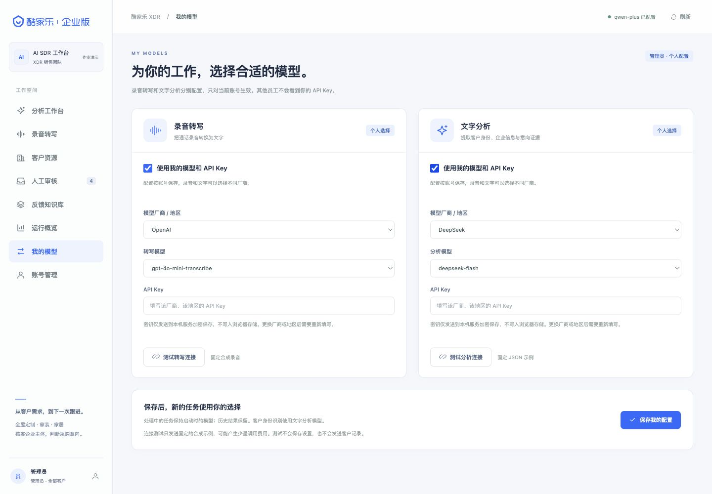

# 个人模型配置

每位员工和管理员都有自己的两项配置：**录音转写**与**文字分析**。它们可以选择不同厂商、不同模型、不同 API Key。客户身份识别复用该员工的文字分析配置。

## 页面操作

1. 登录自己的账号，打开左侧「我的模型」。
2. 在需要修改的卡片勾选「使用我的模型和 API Key」。
3. 选择厂商及地区，再选择模型；列表之外的兼容型号可选择「输入其他兼容模型 ID」。
4. 输入该厂商、该地区的个人 API Key。可先点击对应的连接测试，再点击「保存我的配置」。两项配置一起保存，失败时都不会部分生效。
5. 返回「录音转写」或「通话分析」创建新任务。个人配置保存后无需重启服务。

上图仅演示不同厂商的选择方式，没有填写或保存真实密钥。

测试只发送固定 JSON 示例或仓库中的约 1.7 秒合成语音，不发送客户记录，可能产生少量厂商费用。测试不会保存配置；页面明确提示仍须保存。每个账号同时只能进行一项连接测试，两次测试至少间隔 10 秒。

| 功能 | 已接入的厂商 | 接口要求 |
|---|---|---|
| 录音转写 | 阿里云百炼（北京、新加坡）、OpenAI | Qwen-ASR 兼容接口或 OpenAI Audio Transcriptions |
| 文字分析及客户身份识别 | 阿里云百炼（北京、新加坡）、OpenAI、DeepSeek | Chat Completions，支持 JSON 对象输出 |

预设型号由页面提供；手填型号仍须满足已接入的接口能力及厂商账号权限。转写不支持任意聊天模型、实时音频接口或自动说话人分离型号。个人配置使用固定的官方服务地址，当前不提供自定义代理地址。长录音仍支持不超过 60 分钟、200 MiB，超过单段限制会本地转换和分段。

## 密钥和默认值

- 密钥保存后不回显，读取接口仅返回是否已配置。浏览器不把它写入 localStorage 或 sessionStorage；离开页面或退出登录会移除页面中的输入。
- 同一厂商及地区下，密钥框留空会保留**当前账号已经保存的个人密钥**。更换厂商、地区，或第一次从工作区默认切到个人配置时，必须填写新的密钥。
- 勾选「清除这项个人密钥」并保存会移除该项凭据；后续相应模型调用提示缺少密钥，不会自动回退。填写新密钥和清除密钥不能同时提交。
- 取消「使用我的模型和 API Key」并保存，会移除该项个人配置，明确改用工作区环境默认值。默认值来自服务端 `.env` 或进程环境；未配置默认密钥时不能调用云端模型。
- 环境中的 `DASHSCOPE_API_KEY` 可同时作为两项默认密钥；`SDR_LLM_API_KEY` 和 `SDR_ASR_API_KEY` 可分别覆盖。若工作区要求每人必须自备密钥，应由部署者移除这些共享默认凭据。页面不会把默认密钥复制为个人密钥。

管理员管理客户和账号，但应用没有读取、替换其他员工个人模型配置的接口。后端从登录会话确定配置归属，不接受客户端指定其他账号。

## 任务与客户转交

任务开始执行时一次性读取发起员工的两项配置。同一转写任务的全部片段及其自动客户身份识别使用这份配置快照；处理过程中保存新设置，只影响随后开始的任务。历史结果保留原来的模型信息。

管理员转交客户不会复制员工的 API Key。新负责人对自己有权限的记录发起分析、重试转写或单独重试身份识别时，使用新负责人的配置。管理员代为发起任务时使用管理员自己的配置。已发出的模型请求不会因调配立即取消；新任务开始时会重新校验访问权限。

长录音重试可复用已完成片段。如果转写厂商、模型或分段方案变化，系统会阻止混用旧片段，提示恢复原设置重试或重新上传。更换同一服务及模型的 API Key 不会使已经成功的片段失效。

## 加密与备份

SQLite 的 `model_preferences` 按账号保存两项配置，API Key 用 Fernet 加密。加密主密钥位于数据库同目录的 `model-settings.key`，新建文件权限为 `0600`；默认位置是 `var/model-settings.key`。

**备份必须同时保留数据库和对应的 `model-settings.key`。** 迁移或恢复时应作为同一组保护。只有数据库备份无法解密个人凭据；主密钥缺失或不匹配时系统报错，不会静默生成替代密钥或切换到其他人的凭据。源码交付包排除整个 `var`、`.env` 和虚拟环境。

加密保护数据库中凭据的直接读取，但能读取服务器数据库和主密钥的操作系统管理员仍有能力解密，因此这不是对主机管理员的隔离。清除页面密钥不等于在厂商处撤销 API Key，历史备份也可能保留旧密文；需要撤销时应到厂商控制台处理。

## 错误与验证范围

连接错误仅返回经过处理的提示，不向页面回传厂商原始错误体。密钥错误、模型权限、调用频率及账务问题有不同提示；模型失败保留原文和失败记录，不伪造成功或改用离线规则结果。

2026 年 10 月 20 日验证：105 项自动化测试、12 条合成规则回归通过。新增覆盖账号隔离、加密、密钥保留和清除、配置版本冲突、两项原子保存、任务配置快照、客户转交重试、OpenAI 转写请求格式、JSON 输出契约和错误信息脱敏。

本次使用现有阿里云凭据，对固定合成示例的实际连接测试中，转写与文字接口均返回 HTTP 400、错误码 `Arrearage`，因此当前真实调用被厂商账务状态阻断。需处理账户余额/额度或使用可用的个人密钥后再测。此次未用真实 OpenAI 或 DeepSeek 凭据联调，相关适配通过的是本地模拟接口契约测试，不能据此保证所有模型版本的真实调用或语义效果。此前合成录音成功的历史记录与本次失败报告分别保留，详见 `eval/artifacts/personal-models-live.json` 和 [验收记录](验收记录.md)。
