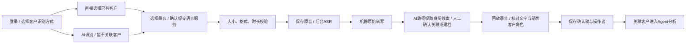

> 版本说明（2026-10-20）：当前企业抬头为 entity-4.0：保留客户原话，企查查 MCP 召回候选，多候选不自动选择，人工确认后输出全称；评分为 intent-3.1 单一总分，0–5 分异常逐条处理；审核理由选填。最新完整流程以 README 和实现同步版设计书为准，历史截图／演示步骤可能保留旧口径。

# v0.2 · 账号、客户资源与电话录音（含双路径客户识别）

本版本把客户档案作为权限边界。一位客户可以有多次通话、录音与审核历史；管理员转交的是客户档案，相关记录自动跟随当前负责人。

每位员工可在「我的模型」分别配置录音转写和文字分析的厂商、型号及个人 API Key，保存后新任务生效。客户身份识别使用文字分析模型；详细操作与加密备份说明见 [个人模型配置](个人模型配置.md)。本篇后续阿里云配置是工作区默认示例，个人配置可在页面中覆盖。

## 启动与账号

执行 `./run.sh`。首次运行安装依赖并生成首个 `admin` 账号，随机密码存于 `var/初始管理员账号.txt`，文件权限为0600。已有账号时不会覆盖密码。手工安装流程执行 `.venv/bin/python scripts/init_admin.py`，再启动服务。

登录后，管理员在「账号管理」创建员工，填写姓名、唯一小写登录账号和至少12字符的密码。可创建另一名管理员，以便完成管理员初审记录的独立复核。员工自行修改密码位于左下角「账号与安全」。密码修改、管理员重置密码或停用账号都会撤销其全部会话；不能停用当前登录管理员。

没有公共默认密码，不再接受 `X-Demo-Actor` 或旧版审核Bearer令牌。可用于体验的员工账号若由本机验收产生，其随机凭据只保存在本机 `var/演示员工账号.json`，不随源码发布。

| 能力 | 员工 | 管理员 |
|---|---|---|
| 客户、录音、通话、审核、导出、统计 | 自己负责的客户 | 全部客户及待分配池 |
| 新建客户 | 自动归自己 | 选择负责人或暂存待分配池 |
| 单条/批量分配、转交、回收客户 | 不允许 | 允许，必须填写原因 |
| 账号创建、停用和密码重置 | 不允许 | 允许 |
| 个人密码修改和退出登录 | 允许 | 允许 |
| 个人转写/文字模型与密钥配置 | 仅自己的配置 | 仅自己的配置，不可读取员工密钥 |
| 独立复核 | 必须有该客户权限且不是初审人 | 必须不是初审人 |
| 反馈发布/撤回 | 不允许 | 发布还需独立于原修正人 |

员工的独立复核一般由管理员完成；不会为了复核而允许员工查看全体客户。管理员自己的高影响修订由另一管理员复核。

## 管理客户资源

1. 在「客户资源」创建客户档案，可填写常用名称、联系人、电话和备注。这些内容只用于管理，不自动代填模型事实。
2. 管理员按负责人筛选，查看每位员工的客户数量、分析数量和录音数量。
3. 点击单条「转交」，或勾选客户后选择「分配 / 转交客户」。预览列出当前负责人，选择新负责人并填写原因。
4. 选择「待分配客户池」可回收客户。员工无法访问未分配客户。
5. 客户档案可查看通话及调配记录。调配保留原始上传人、审核人和历史快照，不把历史作者改写成新负责人。

分配提交采用客户修订号和SQLite事务：任意一个客户版本过期，整批回滚。审核批次即使已经预览，提交时仍检查当前归属；转交后旧员工不能继续通过旧页面提交。原员工已经在外部保存的导出文件不在系统可撤销范围内。

升级旧数据库时，每条旧通话先生成一个待分配档案，不依据相同公司名自动合并客户。管理员可先分配；本版未实现客户档案合并。

## 录音转写流程



配置独立的语音服务密钥；也支持已有 `DASHSCOPE_API_KEY`。只配置 `SDR_LLM_API_KEY` 不会自动把它交给另一种服务。

```dotenv
SDR_ASR_API_KEY=在本机填写
SDR_ASR_BASE_URL=https://dashscope.aliyuncs.com/compatible-mode/v1
SDR_ASR_MODEL=qwen3-asr-flash
```

选择「录音转写」→ 客户识别方式 → 数据类型 → 选择文件 → 勾选云端处理说明 → 上传。录音原始声音会发送到已配置服务；原音不能像文本手机号一样预先替换占位符。


### 两种客户识别方式

- **选择已有客户**：按客户名称、联系人或电话搜索自己有权查看的客户档案；上传时直接关联，保持原有流程。
- **AI识别客户**：无需预先选客户或建立占位档案。转写完成后使用已配置的文本大模型，从通话中提取公司、联系人、电话和业务类型，展示每条线索的原文依据。结果在本机与当前有权访问的客户档案匹配；客户列表不会整体提交给模型。选中候选后点击「确认关联客户」，或切换到「新建客户档案」，核对填写后一次性创建并关联，默认由操作人负责。

AI判断来自录音转写中的身份自述与确认语境，不是声纹认证。销售自我介绍、未被确认的称呼、被否认的身份或第三方名字不能作为客户身份。身份不明确时不推荐客户；即使只有一个同名候选也不会自动关联。名称相近和联系人同名只是建议，不是概率或法律主体认证。新增Prompt为 `prompts/audio_identity_v1.md`，服务端校验结构和引用确实存在，但仍需人核对语义。

未关联录音只允许上传人和管理员访问，确认后立即遵循所关联客户的当前负责人。候选列表每次读取都按当前权限重新计算；客户转交后旧员工无法提交关联。确认客户使用录音修订号和事务；双击、过期页面和重复建档提交不会创建两份档案。客户一旦关联，不能通过此入口换绑其他客户；资源转交仍由管理员在客户资源页完成。

客户识别失败或服务重启不会丢失已成功的转写，可单独「重新识别客户」，无需重新付费转写，也可直接人工归档。保存修改后的校对稿会使尚未确认的旧建议失效，重新识别使用已保存的校对稿；原始机器转写仍保留。直接分析前必须同时满足「客户归属已确认」与「角色校对稿已保存」。

AI方式会在语音转写费用之外增加文本模型调用费用，页面会明确提示发送转写内容；已有客户方式不额外调用客户识别模型。需配置 `SDR_LLM_API_KEY` 或 `DASHSCOPE_API_KEY`，只配置ASR密钥时AI选项禁用。

支持WAV、MP3、M4A、FLAC、OGG，单文件≤200 MiB、录音≤60分钟（页面简写为200 MB）。服务端解析文件内容并验证时长，不能靠改扩展名绕过。超过3分钟或大于7,000,000字节的录音会在本机转换为16kHz单声道PCM，再按最长3分钟一段转写；尽量选择片尾静音处切分，所有音频帧按顺序覆盖，不以文字去重删除真实重复发言。WAV和M4A已有真实ASR验证，MP3/M4A的本地转换另有自动化测试；其他格式仍需用目标业务录音验证兼容性。

原来的5分钟限制来自 [Qwen3-ASR-Flash单次请求限制](https://help.aliyun.com/zh/model-studio/qwen3-asr-flash)，本次通过本地分段继续使用现有模型和密钥。每个3分钟PCM片段约5.76MB，低于提供商10MB限制；原音只在本地保留，按片段发送到语音服务，无需配置公开下载链接。安装依赖时会安装 `imageio-ffmpeg`，其常用平台wheel包含FFmpeg；已有环境重新运行 `./run.sh` 会补齐该依赖。

### 批量上传并自动分析

录音页的文件选择器支持多选，主上传按钮和「批量上传并自动分析」都能一次处理多份。选择已有客户时多份录音归入同一客户，否则按文件名自动建档。每份录音自动执行；单个上传选择已有客户时默认勾选「上传后自动确认角色并提交分析」：ASR 转写 → AI 分角色 → 自动确认校对稿 → 按文件名创建客户 → 提交分析。电话、联系人可以留空，审核时再补；企业抬头仍走企查查候选和人工确认。

自动确认时，「待确认」语句保留为「待确认」，在记录中明确标记并暂不参与客户事实；如果整段没有客户发言，会把最长的一段提升为「客户」并标记兜底。录音列表、分析结果和审核页都会显示待确认数量。未配置文字模型时，整段按「客户：原文」兜底，分析继续。已有客户、角色已就绪且没有待确认时，打开录音详情会自动提交分析，不需要再点「直接分析这段录音」。自动分析失败会在录音详情页显示错误，可重试；录音、原始转写和已确认稿都会保留。自动分析不会绕过人工审核，结果仍进入审核队列。

详情页显示分段时间范围、已完成数量和每段文字，并可定位回放。失败或服务重启后，点击「继续未完成片段」会复用数据库中已保存的成功结果；只有全部完成后才生成完整机器转写，随后才进行AI客户识别。模型已处理但响应丢失的片段可能需要重新调用，不能保证这种情况不产生重复计费。每次按需解码，临时文件正常退出时清理；原始录音不改写。

每份校对稿与分析输入最多100,000字符。分段时间是片段边界，不是逐字时间戳；静音切分不能保证绝不截断词句，仍须对照原音校对。超长文本的下游理解仍使用完整文本一次调用，没有独立的跨片事实抽取与冲突合并流程。

模型使用 [Qwen-ASR官方兼容接口](https://help.aliyun.com/zh/model-studio/qwen-asr-api-reference)，通过`input_audio`传Base64。这里的兼容格式不要求安装OpenAI SDK；调用由httpx完成。默认语音模型输出文字后，由该员工的文字模型生成销售/客户角色建议。请在详情页「逐条确认角色」处理待确认语句，并核对完整校对稿：

```text
销售：您好，您近期有哪些设计需求？
客户：出图比较慢，想在下周试用一下。
```

待确认语句可以选择「设为销售」「设为客户」「其他／系统播报」或「保留存疑」，也可以直接编辑校对框。前两项分别写入销售、客户标签；后两项写入「其他：」「存疑：」，保留原句但不提交给事实抽取模型，也不能选作评分或企业信息证据。每个非空行都须带有效角色且有内容，至少包含一段已确认客户发言；不能将整段通话全部标为其他或存疑。

处理后点击「保存校对并确认角色」，再点击「直接分析这段录音」。尚未确认客户归属时，先在上方关联客户。仅选择按钮不会自动保存，也不会自动发起模型分析。页面按当前校对稿实时显示剩余待确认数量和下一步提示；展开的「AI 原始建议」保持历史结果，修改以校对稿为准。保存确认后仍可再次校对，保留修改记录；已创建的分析保留当时确认版本，不随新校对稿变化。分析导出附客户、录音及确认修订来源。不能把某客户的转写关联到另一客户，不能更改录音原有的数据类型。

| 录音状态 | 下一步 |
|---|---|
| queued / running | 等待后台转写，可离开页面 |
| transcribed | 回放并校对角色、企业名称、姓名和数字 |
| confirmed | 使用确认稿创建分析，或继续修订校对稿 |
| failed / interrupted | 查看明确错误，主动重试；原音保留 |

机器转写、人工校对稿、原音分别保存。录音接口验证客户归属；尚未归属时验证上传人或管理员身份，不能通过猜ID获取他人的音频。删除仅允许未关联分析且不在处理中的录音，防止已审核分析失去原始证据。默认原始音频存储额度2 GiB、并发转写2个、排队中和运行中合计最多10个；超过限额明确阻断。

转写失败不会静默回退为虚构文字。服务重启把未完成转写标为中断，员工主动重试；不声称后台线程池是可跨节点恢复的分布式队列。

## 审核颜色与处理顺序

| 默认顺序 | 状态 | 颜色 | 含义 |
|---|---|---|---|
| 1 | 分析异常 | 红色 | 分析失败或中断，优先处理运行问题 |
| 2 | 待独立复核 | 紫色 | 高影响修改等待另一账号确认 |
| 3 | 审核中 | 蓝色 | 已开始人工修订 |
| 4 | 待审核 | 黄色 | 等待初审 |
| 5 | 待补证 | 橙色 | 需额外信息，暂缓处理 |
| 6 | 分析中 | 青色 | 后台计算中 |
| 7 | 已通过 | 绿色 | 审核完成 |
| 8 | 已排除 | 玫红 | 人工排除 |
| 9 | 无需审核 | 灰色 | 例如低意向或拒联，由业务规则处理 |

同状态按高意向→中意向→未知→低意向，同意向按较早创建的记录在前。排序由后端统一定义，前端同时显示文字、颜色及分组，颜色不是唯一信息来源。已暂缓或已排除的记录即使历史上曾等待独立复核，也不会继续挤占复核优先级。

## 鉴权实现与部署边界

- PBKDF2-HMAC-SHA256，600,000次迭代与独立随机盐；随机会话值只放HttpOnly、SameSite=Strict Cookie，数据库只存会话哈希，会话最长12小时。
- 登录按IP+账号限制失败尝试，并限制单IP总尝试数；同账号连续5次或单IP30次会在滚动15分钟窗口内限流。仅在密码校验成功且账号仍启用时签发会话。
- 写请求校验CSRF值及Origin；账号、客户分配、审核批量等写事务再次检查身份或归属。
- 员工只能访问其归属客户的反馈。已发布企业别名只用于同客户后续分析，避免通过共享候选间接泄露他人客户信息。
- 本机HTTP使用非Secure Cookie；对外监听必须设`SDR_COOKIE_SECURE=true`并通过HTTPS反向代理访问。应限制外部直接访问后端端口。
- 单实例部署中的登录限流按直连客户端IP计算；反向代理转发配置需联调，不能直接信任任意客户端伪造的X-Forwarded-For。
- 这是单销售团队的应用，不是多租户平台；未实现SSO、MFA、复杂组织树、自动客户合并、真实电话噪声准确率评测及多节点任务恢复。

## 验证与交付

自动化测试：`.venv/bin/python -m pytest`。单次真实ASR接口测试命令会发送所选录音并可能计费，只用于已获授权的≤5分钟、≤10MB录音；长录音从工作台上传以验证完整分段流程：

```bash
.venv/bin/python scripts/smoke_asr.py --audio /绝对路径/合成录音.wav --synthetic
```

结果只表示该测试文件的实际服务响应。录音、数据库、备份、初始凭据、模型密钥均位于源码包排除范围。真实录音测试报告含转写内容时，也不应直接对外发布；本次交付包只保留合成音频报告。


### 上传时提示无法读取音频

上传校验发生在调用云端语音服务之前。旧版把解析失败、文件内容与后缀不一致、时长为0秒混为一条提示，不能据此认定录音已经损坏。现在分别提示：空文件、只有文件头/零时长、ZIP压缩包、下载网页、实际格式与后缀不一致、RF64/RIFX暂不兼容，以及其他音频信息解析失败。

保留原始文件，先确认本机能正常播放；可播放但上传仍失败时，需要检查该文件的真实容器和编码，不要只修改后缀。可以提供文件或其本地路径进行诊断，或用音频软件重新导出标准PCM WAV/MP3。本次没有取得用户报错的原始文件，尚不能判断该文件的具体原因；这次修正的是诊断提示，未声称已经解决所有编码兼容性。
