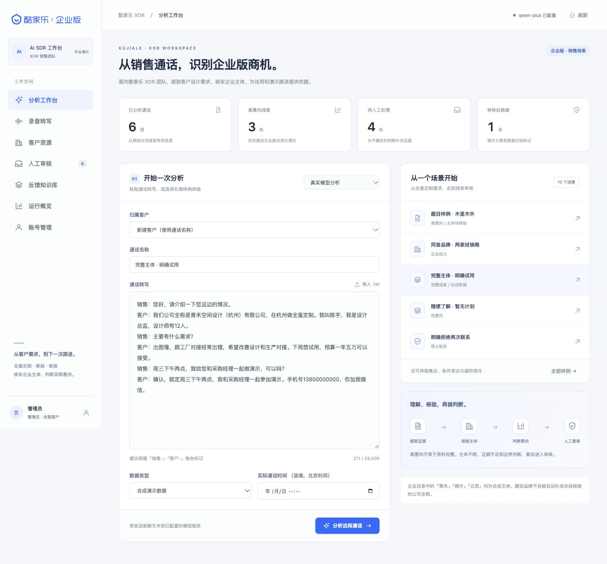
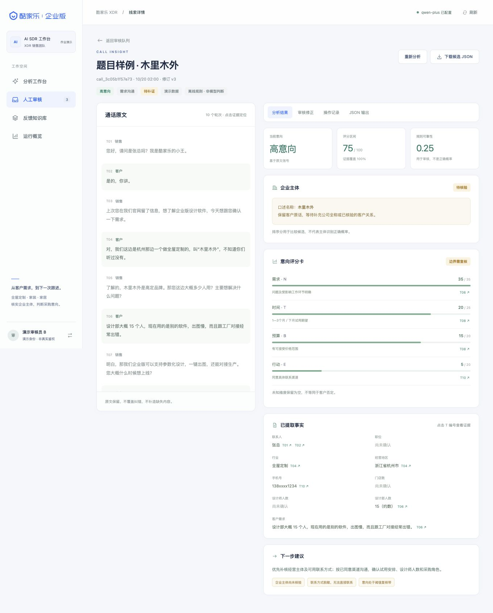
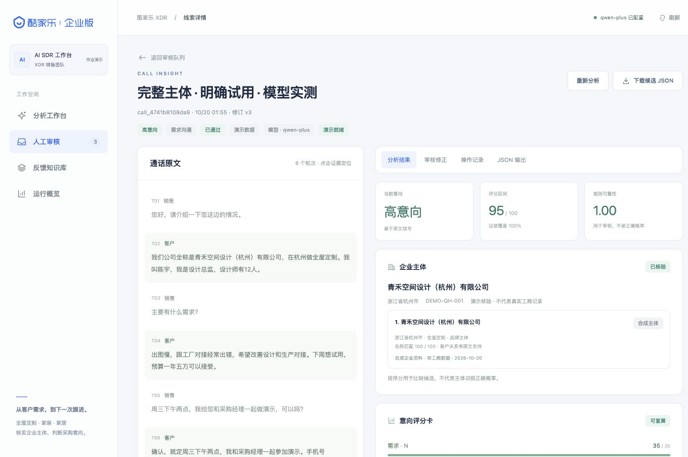
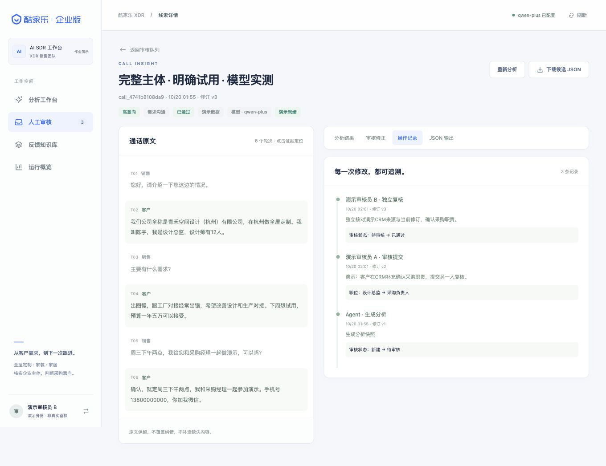
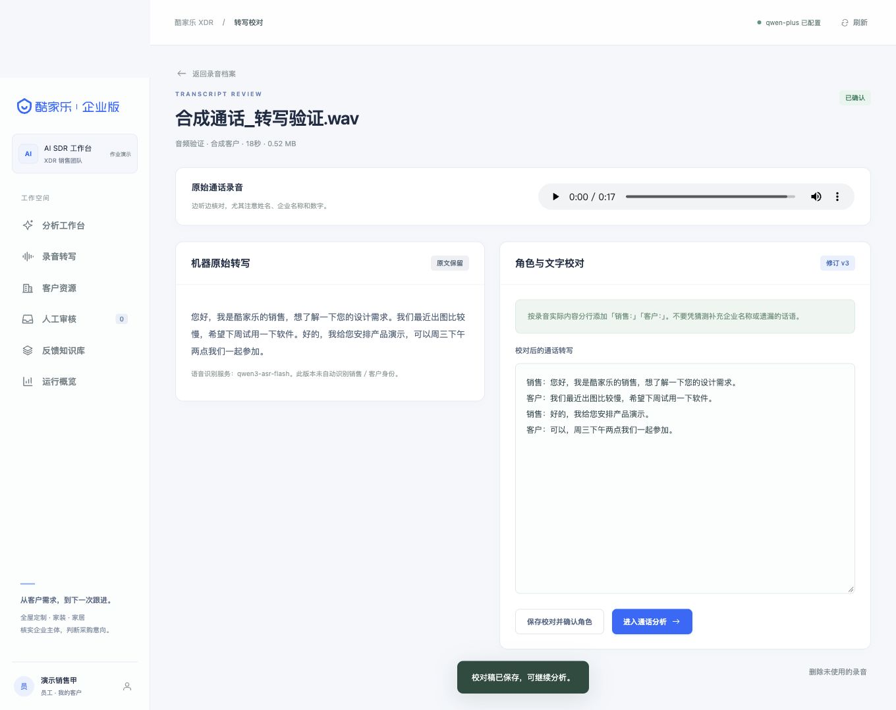

# 运行过程与 GitHub 展示

这份文档用于在 GitHub 上快速展示“项目能跑、能处理、能审核”，也方便面试官按步骤复现。

## 1. 本地启动

```bash
git clone https://github.com/dhc979917-ux/AI-SDR-Agent.git
cd AI-SDR-Agent
./run.sh
```

打开 `http://127.0.0.1:8765`。8765 是默认本地端口，可用 `./run.sh --port 9000` 修改；别人访问时请使用在线 Demo 地址，不要发 `127.0.0.1`。首次启动会创建管理员，凭据在 `var/初始管理员账号.txt`。

没有模型密钥时，使用「离线规则演示」；企查查、文字模型和 ASR 都是可选配置。公网演示不要使用真实客户数据。

## 2. 演示路径

### 2.1 题目样例：从通话到高意向线索

1. 进入「分析工作台」。
2. 选择「题目样例 · 木里木外」。
3. 点击「分析这段通话」；分析中可在进度页点「停止分析」。
4. 观察：意向 75 分、需求/时间/预算/行动四维证据、企业抬头候选。

预期结果：高意向，但电话脱敏，因此不能作为正式 SQL 交付；企业名称不直接补成工商全称。



### 2.2 企业抬头：企查查召回与第二层重排

1. 打开分析结果中的企业抬头卡片。
2. 查看客户原话、企查查候选、AI 重排名次、置信度、地区、信用代码。
3. 只说不含全称的品牌时，不自动确认；客户说完整全称时，唯一 exact 才自动确认。
4. 进入「审核修正」可以改选其他候选；改选会进入独立复核。



### 2.3 意向评分：规则解释，不让模型直接定级

1. 查看 N/T/B/E 四维分数和证据轮次。
2. 说明为什么“下个月试用”是 20 分、“一年几万”是 15 分。
3. 说明未提及维度保留 `unknown`，不等于客户明确否定。
4. 0–5 分异常需要逐条核听，不能批量改等级。



### 2.4 人工审核：证据、复核、审计

1. 进入「人工审核」。
2. 打开一条待审核记录。
3. 观察「原文证据轮次」已由 AI 预填；聚焦字段会带入该字段证据。
4. 修改字段或选择候选，保存草稿。
5. 高影响修改进入不同账号独立复核；查看审计差异。



### 2.5 录音与批量

1. 进入「录音转写」。
2. 上传一段合成录音，或选择多条录音批量上传。
3. 观察自动流程：ASR → AI 分角色 → 自动确认 → 自动建档 → 提交分析。
4. 如果有「待确认」语句，列表显示数量；这些语句标记为不参与事实抽取。
5. 在分析工作台多选 TXT，主按钮会变成「批量分析 N 个文件」。



## 3. 验证命令

```bash
python -m pytest -q
node --test tests/test_audio_confirmation.cjs
node --check static/app.js
node --check static/team.js
node --check static/audio-roles.js
python scripts/evaluate.py
```

当前结果：229 项 Python 测试、7 项前端测试、12/12 合成规则回归。企查查真实冒烟 6/6 有预期候选，具体边界见 `docs/验收记录.md`。

## 4. GitHub 上怎么展示更好

### 4.1 README 顶部放什么

建议顺序：

1. 一句话项目定位。
2. 在线 Demo 地址（Render 稳定地址）。
3. 3–5 个技术标签：Python、FastAPI、SQLite、企查查 MCP、Human-in-the-loop。
4. 一张工作台截图或 30–60 秒 GIF。
5. 「运行过程」链接到本文档。
6. CI 徽章和测试结果。

### 4.2 截图与 GIF

- 静态截图放 `docs/screenshots/`，在 README 用相对路径引用。
- 动态过程建议录 30–60 秒 GIF：工作台 → 分析 → 企业抬头候选 → 审核证据 → 批量入口。
- macOS 可用 `Cmd + Shift + 5` 录屏，再用 `ffmpeg` 或 `gifski` 转 GIF：

```bash
ffmpeg -i demo.mov -vf "fps=12,scale=1280:-1" -q:v 8 docs/screenshots/demo.gif
```

- GIF 尽量控制在 10 MB 内；更长的 5–10 分钟讲解视频放到 Bilibili/YouTube，README 放链接，或上传到 GitHub Release 作为 MP4 附件。
- 不要展示 `.env`、token、真实录音、真实手机号。

### 4.3 GitHub 仓库设置

- **About → Website**：填 Render/在线 Demo 地址。
- **Topics**：`ai-sdr`、`fastapi`、`sqlite`、`qcc`、`sales-lead`、`human-in-the-loop`。
- **Actions**：启用 workflow，README 顶部放 CI 徽章。
- **Releases**：创建 tag，如 `v0.4.0`，附带设计 PDF、演示视频或交付 zip。
- **Pin repository**：在个人主页置顶。

### 4.4 CI 徽章

工作流文件：`.github/workflows/ci.yml`。README 中放：

```markdown

```

CI 会执行 Python 测试、合成回归、前端测试和 JS 语法检查；每次 push 都能看到绿色通过记录。

## 5. 展示时的边界

- 不要把合成回归 12/12 说成真实业务准确率。
- 不要把企查查冒烟 6/6 说成真实企业识别准确率。
- 自动确认只针对唯一完整全称 exact；品牌简称、经销商和多候选仍需要人工。
- 公网 Demo 如果是 Render 免费实例，会休眠、数据不持久；长期演示用付费实例或持久卷。
